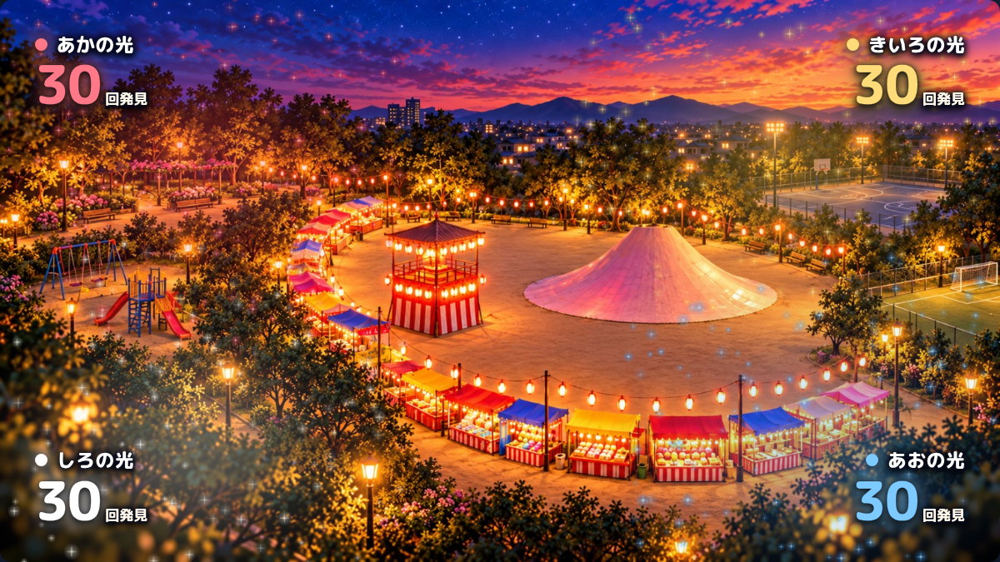
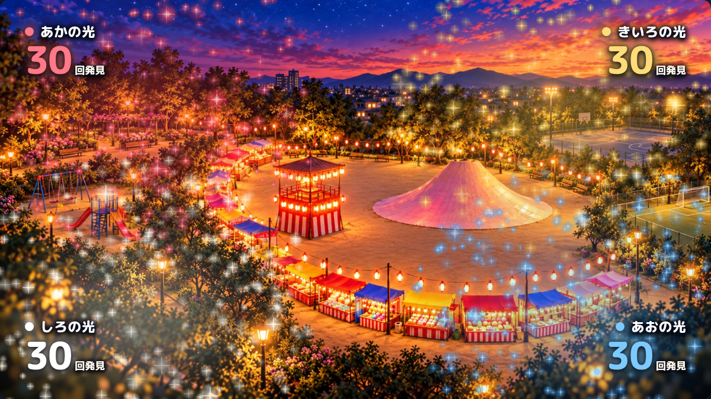

# 受付スクリーン：30回でキラキラ最大

色ごとの発見が増えるにつれて星くずの数・大きさ・輝き・広がりを増やし、**各色30回で演出が最大**になるよう調整しました。31回以降も発見数の数字と保存は増え続けます。

- 最大の星くずは1色240粒。白く輝く芯と長めの十字光を加え、ときどき大きな星がきらめきます。
- 星の描画を色別に使い回し、4色が最大になっても毎フレーム発光画像を作り直さない構成です。
- 固定背景、4隅のカウント配置、発見数と提灯の役割の分離は維持しています。実QR・スマホ・DBとの連携は引き続きデモの対象外です。

## 同じ30回での比較

| 変更前 | 変更後 |
| --- | --- |
|  |  |

## 確認結果

Chromium 154とWebKit 26.5の両方で、次を確認しました。

- 0・1・15・29・30回と増やすと、星くず全体の光量が増える。
- モーション軽減で時刻を固定すると、30回のCanvas画像は31・100回と一致し、29回とは異なる。
- 100回の後も101回へ加算でき、再読み込みしても101回が残る。
- 通常設定では星くずが実際に動く。モーション軽減時は静止表示。
- 幅360・390・430pxでも横スクロールがなく、16:9の比率を維持。

画面の「全色に5回ずつ追加（テスト）」を押して、30回までの見た目を確認できます。公開サイトへの反映は、この変更のPRを`main`へマージした後のPagesデプロイで行われます。
