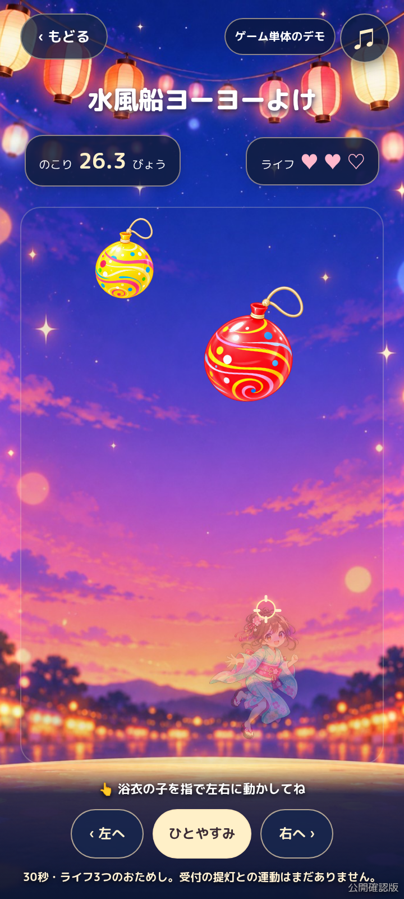
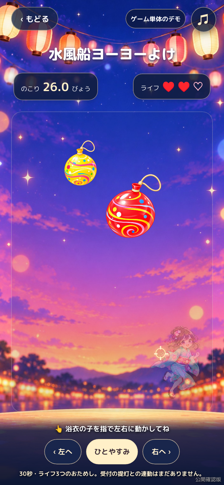
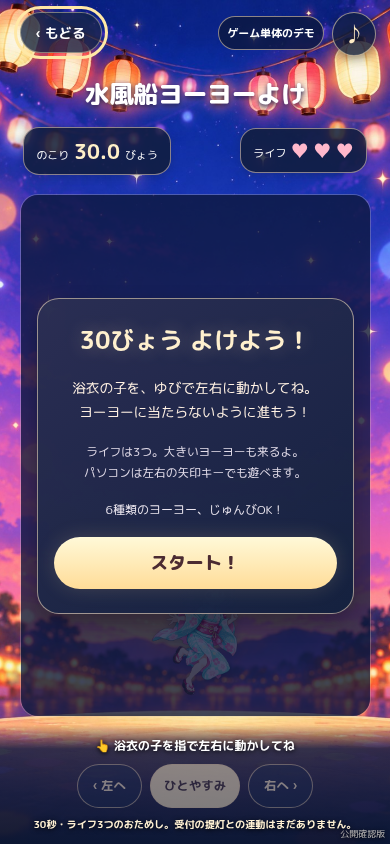
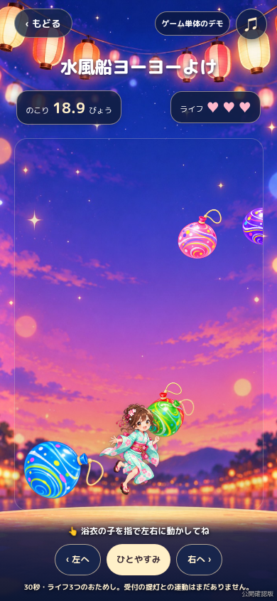
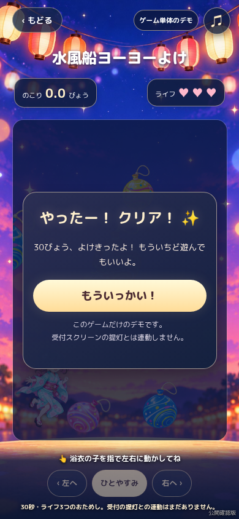
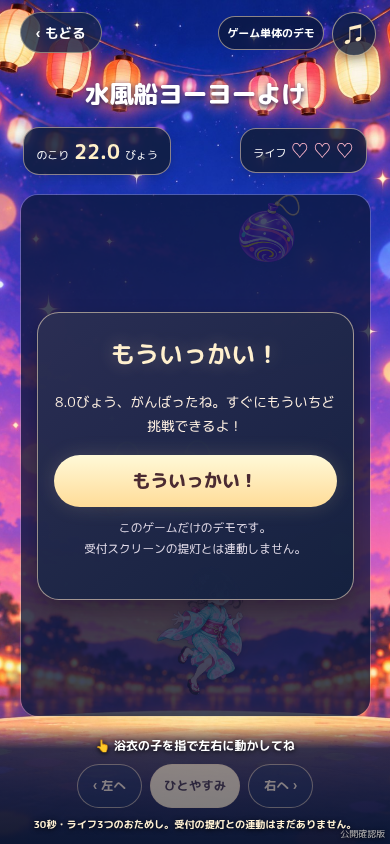
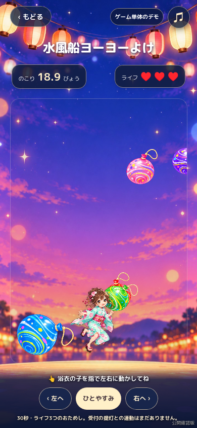

# 赤の光：水風船ヨーヨーよけ

新しいヨーヨー素材ZIPの指示に沿って、赤の素材確認画面を、スマートフォンで遊べる**ゲーム単体のデモ**に改修しています。既存の背景、水色浴衣の女の子、赤い光の発見から進む導線を引き継ぎ、追加指定された専用BGMを組み込みました。

提供された指示書は [README_FIRST.md](handoff-red-yoyo/README_FIRST.md) と [CODEX_PROMPT.md](handoff-red-yoyo/CODEX_PROMPT.md) に保存しています。

## 遊び方

1. 赤い光の発見画面からゲームへ進むか、`index.html#red` を開きます。
2. スタートボタンを押し、浴衣の子を指で左右へ動かしてヨーヨーをよけます。画面の左右ボタンと、PCの左右矢印キーでも操作できます。
3. 初期設定は30秒、ライフ3つです。ライフがなくなったら再挑戦でき、30秒を完走するとクリア画面になります。

ゲーム中は一時停止・再開ができます。プレイ途中で画面を離れたりブラウザーが裏に回ったりした間は、時間や被弾が進みません。戻ったら再開ボタンで続けられます。ページを再読み込みすると開始前に戻ります。開始前には素材の読み込みを確認し、準備ができてからスタートします。

## ヨーヨーと当たり判定

- 赤・青・黄・緑・紫・桃の6種類を、同じ種類ばかり続かない順番で使います。
- 上・左右・斜めから飛来し、速度と角度にばらつきがあります。序盤は少なめで、時間が進むと出現頻度が少し上がります。
- 大型は約18%。通常のものより遅くして、避ける時間を確保します。
- 左右から出るときも、浴衣の子のすぐ近くに突然現れないよう、画面上側から接近させます。下からの突然の出現はありません。
- 女の子は、採用済みPNGの不透明な輪郭（頭・胴体・袖・足）を72×96の水平区間として取り出した判定を使います。透明な余白や体の隙間は対象にしません。画像左上・幅・高さを、画面表示と同じ座標から計算します。
- ヨーヨーは紐を除いたゴム球の内側を判定に使い、PNGを回転表示したときも球の中心を同じ角度で回します。
- 当たるとライフを1つ減らし、その描画フレームでハートを更新します。女の子は短く点滅し、接触点に小さな輪と光を表示します。約1.1秒の無敵時間中は続けてライフが減りません。
- 頭まで判定が届く分、飛来時の最低予告時間も女の子の画像上端を基準に計算します。
- 画面外へ出たヨーヨーを除去し、同時表示数にも上限を設けています。

時間・ライフ・大型の割合などの初期値は、`js/red-game-model.js` の `DEFAULT_CONFIG` で調節します。画面サイズによってゲーム時間やライフが変わることはありません。本番向けの難しさやバランスは、実機で遊んでから調整できます。

### 2026年10月23日：1日目の難易度を少しやさしく

実際にスマホで遊んでクリアが難しかったため、ヨーヨーの速度を約12%落とし（通常速度112〜160 → 100〜140）、出現間隔を序盤1.18→1.33秒、終盤0.64→0.75秒へ少し延ばしました。30秒・ライフ3つ・当たり判定・無敵時間・6種類の画像・大型ヨーヨーの割合・専用BGMは変更していません。※この記述は当時の変更履歴です。現在は2日目の試作を追加しています。

この変更は公開前の確認用PRです。既存のテストに、旧設定と比べて30秒間の出現数が減ることを検証するシナリオを追加しています。実機での遊びやすさはマージ後に確認してください。

### 2026年10月23日：ヨーヨーの出現数をさらに減らす

スマホで遊ぶと「ヨーヨーが多すぎてクリアしづらい」という感想があったため、1日目のおためし難易度をさらにやさしくします。序盤の出現間隔を1.33→2.0秒、終盤を0.75→1.3秒に変更します。30秒あたり約29個から約18個程度に減る見込みです（数は目安で、画面外の描画数や個々の飛行時間ではありません）。

**変更しないもの：** 30秒、ライフ3つ、速度100〜140、6種類のPNG、大型ヨーヨー比率、当たり判定、被弾後の無敵時間、専用BGM、既存のページ遷移。※この記述は当時の変更履歴です。現在は2日目の試作を追加しています。

別ブランチとPRでレビューし、マージ後にスマホ実機で難易度を確認してください。

## 使用する素材

| 素材 | パス |
| --- | --- |
| 決定済みの背景 | `assets/backgrounds/red_game_fixed_1918.png` |
| 採用済みの水色浴衣の女の子 | `assets/red-game/approved_yukata_character.png` |
| 新しい6色のヨーヨー | `assets/red-game/yoyos-v2/yoyo_{red,blue,yellow,green,purple,pink}.png` |
| 共通BGM | `assets/audio/four_lights_of_suzuran.mp3` |
| 赤専用BGM | `assets/audio/summer_yoyo_matsuri.mp3` |

新しいヨーヨーは全て600×600の背景透過PNGです。ZIPからファイル内容を変更せず配置し、6点とも元ファイルとバイト単位で一致することを確認しました。背景や女の子の再生成・差し替えはしていません。以前の切り抜き素材用のCSSマスクは、新しい素材には適用しません。

## 色ごとの音楽

赤の画面では添付の `summer_yoyo_matsuri.mp3` がループ再生され、戻ると共通BGMの続きに戻ります。同じ赤ゲーム内での一時停止・再挑戦では曲を切り替えません。音楽OFFは画面移動をまたいでも保持し、ユーザーが再生操作するまでは無音です。

音楽は1つのaudio要素で管理し、曲の重なりを防いでいます。`js/audio.js` の `TRACKS` が曲の設定場所です。`common` と `red` に採用済みファイルを設定し、`white`・`yellow`・`blue` は未指定のため `null` にしています。各色の承認済み音源が決まったら、同じ形式の `{src, label}` を設定できます。未指定の色は共通BGMを使い、存在しない音源を読み込みません。

## 2日目（2027年8月8日）：ひかるヨーヨーをつかまえろ！

- `index.html?day=2#red` で2日目の赤ゲームを確認できます。1日目は `?day=1#red` です。
- 1日目で好評だった **30秒・ライフ3つ・約18回の出現設定・当たり判定・6種類の画像・背景・浴衣の女の子・赤専用BGM** は変更しません。
- 2日目は一部の通常ヨーヨーを、赤い星マークとやさしい光の輪の付いた「光るヨーヨー」に置き換えます。別途追加出現させないため、画面を混雑させません。
- 通常ヨーヨーは触るとライフが減ります。光るヨーヨーは触れるとライフを減らさず、赤い光を1つ獲得します。各色のヨーヨーが光る可能性があります。
- 光るヨーヨーは左右交互のわかりやすいコースをゆっくり通ります。**3つ目を取った瞬間に勝利が確定**し、残り時間の完走は不要です。
- 時間切れで3つ未達、またはライフ0で失敗。すぐに再挑戦できます。キャッチした数は再挑戦時に0に戻ります。
- クリア後は約4秒の静かな演出：ヨーヨーの動きが止まり、3つの小さな赤い光が1つに集まり、やさしく夜空へ昇ります。大きな花火や激しい点滅は使いません。効果音はBGMがONのときだけ控えめな鈴音を合成します（端末で音が制限される場合は無音でもゲーム可能）。
- 光の3つは**このゲーム内だけの進捗**です。受付スクリーンのカウントを3回加算したり、提灯へ送信したりしません。
- 1日目・2日目とも共通BGMから赤専用の `summer_yoyo_matsuri.mp3` へ切り替わります。

テスト：`tests/red-game.cjs` に2日目の出現・クリア・時間切れ・ライフ・日付切替のテストを追加し、`tests/smoke.cjs` に日付指定の画面操作と約4秒の演出確認を追加しています。ブラウザー自動テストと実機確認はマージ前に別途必要です。

### 2日目の難易度調整：光るヨーヨーの出現を8回→6回（2026年10月24日）

スマホで実際に遊び「少し簡単すぎる」という感想があったため、2日目の光るヨーヨーのチャンスを**8回から6回**に減らし、ラウンド全体に分散させました。光る回は出現順の2・5・8・11・14・17個目（内部ID 1,4,7,10,13,16）。3つ取ればその瞬間にクリアするルールは変更しません。

**光るヨーヨーの速さ、大きさ、当たり判定、キラキラ演出、クリア時の可愛い光、BGMはすべてそのまま。** 通常ヨーヨーと合わせた出現総数（30秒で約18個）は増やしません。1日目の難易度には一切変更を加えません。

日付ごとの出現数・クリア条件をモデルテストで確認できるようにしました。実機でのちょうどよい難しさは、マージ後に遊んで確認してください。

### 2日目のクリアタイミング調整：15秒以降に3個目（2026年10月24日）

「ゲームスタートから15秒以降でクリアできるようにしたい」という実機での感想を受け、**3つ目の光るヨーヨーの登場を15秒後に移動**しました。

- 光るヨーヨーは合計6回。出現順で **2・5・9・11・14・17個目**（0始まりの内部ID `[1,4,8,10,13,16]`）に登場します。
- 既定の出現間隔では、3つ目の光るヨーヨーはゲーム開始**約15.3秒後に出現**し、女の子の位置まで移動するため、実際の3個目取得・クリアはさらに後になります。プレイ中に時間待ちの演出は表示しません。
- 3つキャッチした瞬間にクリアするルールは維持します。光の登場をずらすだけで、30秒制限・ライフ3つ・ヨーヨー総数・移動速度・当たり判定・キラキラ演出・BGM・1日目のゲームには変更を加えません。
- モデルテストで3つ目の出現が15秒以降であること、通常の移動操作で30秒以内に3つ取得して即クリアできることを確認しています。実機での体感は公開後に確認してください。

### 2日目のキラキラ強化（2026年10月24日）

遊んだ際の感想をもとに、ゲームのルール・難易度・音源は変えず、可愛さが伝わる演出を追加しました。

- **光るヨーヨー本体**：採用済みPNGの上に、ピンクと金の柔らかい光の輪、明滅する二重リング、周囲をゆっくり回る7個の小さな四つ星、球面のハイライトをCanvasで重ねます。中央の赤い星マークも維持します。
- **1〜3つ目の取得**：取得位置で小さな星くず・ハートが広がり、上部の獲得数表示が軽く弾むアニメーションを追加。効果音は従来の小さな鈴音をそのまま使います。
- **3つ集めたとき**：3つの赤い光が少し回転しながら1つになり、ふわっと大きく光り、約4秒かけてピンクと金色の小さな星くず・少数のハートとともに空へ昇ります。最後の「あかい光、みつけた！」もやさしくキラキラします。
- **軽量化・見やすさ**：光るヨーヨーにしかCanvasの追加エフェクトを描かず、取得演出のDOM要素は最初に一度だけ生成します（取得の粒9個、クリア時の粒26個）。毎フレームの要素追加や新規画像ダウンロードはありません。高速な明滅や全画面フラッシュは使いません。`prefers-reduced-motion` では動きを抑えた表示にします。
- **維持するもの**：1日目、採用済みの背景・女の子・ヨーヨーのPNG・赤専用BGM、30秒・ライフ3つ・光3つで即クリア、受付カウントとの非連動。

ブラウザーテストへ、粒数・HUDアニメーション・クリア時の装飾・1日目の表示非干渉の確認を追加しました。実機での光の見え方や負荷は公開前に確認してください。

## デモの範囲

クリアはゲーム画面内の結果です。受付スクリーンの発見数・提灯や、他の参加者の端末へは送信しません。GPS、写真投稿、実QR読み取り、外部DB、本番の受付同期も追加していません。

受付スクリーンとキラキラ強化の変更は、この赤ゲーム改修の対象外です。公開先のGitHub Pages URLと、過去のゲーム用リポジトリも変更しません。公開サイトへの反映は、この改修のPRを確認して`main`へマージした後に行います。

## 検証

```sh
npm test
```

赤ゲームの動作モデルは `tests/red-game.cjs`、画面・操作は `tests/smoke.cjs`、実際の画像表示と衝突の一致は `tests/red-collision-visual.cjs` で確認します。スマホ幅360／390／430px、6種類の画像読み込み、スタート・左右操作・ライフ・一時停止・再挑戦・30秒クリア、既存画面の遷移とBGMが対象です。

今回、**動作モデル10項目と、Chromium 154・WebKit 26.5各20項目（画面操作16＋実表示の衝突4）、計50項目が成功**しました。

- 1,200回の出現をシミュレーションし、6種類の使用・連続の偏り防止・5方向の飛来を確認。大型は226回（18.8%）で、通常より遅いことを確認しました。
- 画像の紐・透明な余白では被弾しないこと、体への被弾、無敵時間、ライフ3つ、再挑戦、一時停止、表示数の上限を確認しました。
- 幅360／390／430pxで開始・ボタン・ドラッグ・停止／再開・画面遷移を確認しました。
- ブラウザーでも既定の30秒を通してクリアし、実際の当たり判定でライフが0になって再挑戦できることを確認しました。テスト時計で時間を進めていますが、ゲームの設定・ライフ・当たり判定を書き換えてクリアさせる処理はありません。
- 新しいMP3の再生、赤の画面での曲の継続、共通曲の再開位置、音楽OFFの維持を確認しました。画像・音源の読み込み失敗、ページエラー、外部サービスへの要求はありませんでした。
- 起動、ホーム、QRテスト、ヒント、お店、受付スクリーンの既存操作も確認しました。

Android／iPhone実機、Safariアプリ自体での見え方・音声出力は未確認です。この変更はPRに保存し、公開サイトへの反映はマージ後に行います。

### 当たり判定の修正・実表示での検証

修正前は、幅100・高さ約133で表示する女の子に対し、胴体付近の半径16の円だけで被弾を判定していました。頭や袖にヨーヨーが見た目上重なっても、この円に届かなければライフが減りませんでした。被弾時も半透明になるだけで、点滅と接触エフェクトは表示していませんでした。

今回、体の不透明な輪郭に沿った判定へ変更し、球の判定も6種類それぞれの画像に収まるよう調整しました。描画する女の子とCanvasの原点・縮尺・ヨーヨーの回転を、同じゲーム座標へ対応させています。画像・BGM・操作方法・1日目の30秒／ライフ3つというルールは維持しています。

追加の実表示テストでは、通常設定で自然に出現したヨーヨーへ、通常の入力で女の子を移動します。Chromiumではネイティブのタッチ開始・移動・終了、WebKitではポインタードラッグとタッチボタンを使います。ゲーム状態・設定・ヨーヨーの位置を書き換える操作は行いません。実際のCanvas描画変換と女の子のDOM表示位置を記録し、元PNGの不透明画素を別のCanvasへ描いて重なりを照合します。被弾時にヨーヨーが消えるため、直前の描画位置から1フレーム分の通常移動を進めた位置も検証します。

- Chromium 154／WebKit 26.5、Android相当360×800／iPhone相当390×844、画素倍率2で、頭と腕・袖への衝突を各4項目、計8項目確認しました。
- 描画と判定の対応のずれは最大0.092 CSS px。頭への接触は画像上端付近で発生し、従来の胴体の円では届かない場所です。
- 腕・袖への接近時、画像の四角同士が重なっていても、不透明画素が重ならない透明部分ではライフ3つを維持しました。
- 被弾したフレームでハートが3→2へ更新され、点滅・接触点の小さなエフェクトが出ることを確認。被弾から約1秒後もライフ2つで、残り約0.08〜0.09秒の無敵時間がありました。
- ゲーム画面には当たり判定線などのデバッグ表示を出していません。テスト時だけ描画を観測し、画像・数値記録を `tests/artifacts/` に出力します。

| Android相当・頭への被弾直後 | iPhone相当・腕／袖への被弾直後 |
| --- | --- |
|  |  |

## ゲーム画面

| 開始前 | プレイ中 |
| --- | --- |
|  |  |

| 30秒クリア | 失敗・再挑戦 |
| --- | --- |
|  |  |

WebKitでも同じ素材・構成で動作します。


