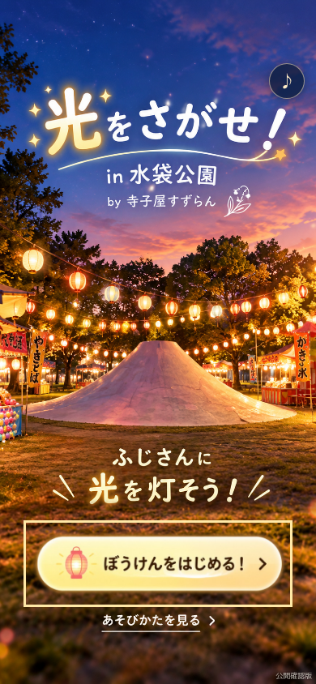
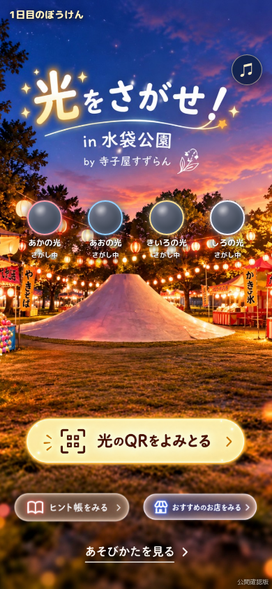
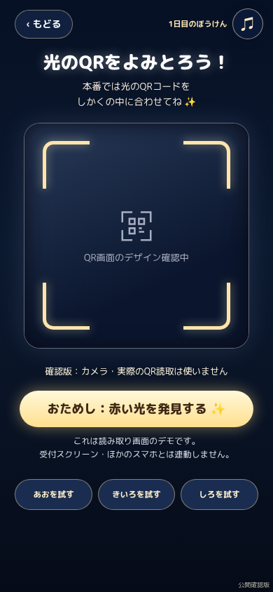
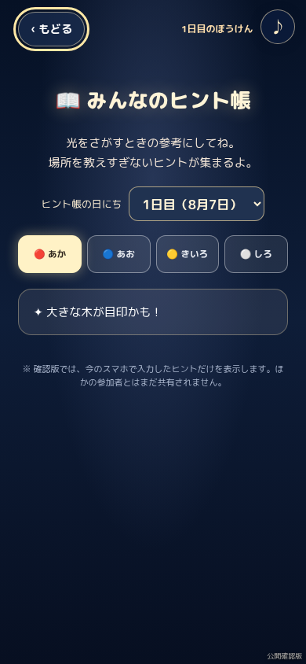
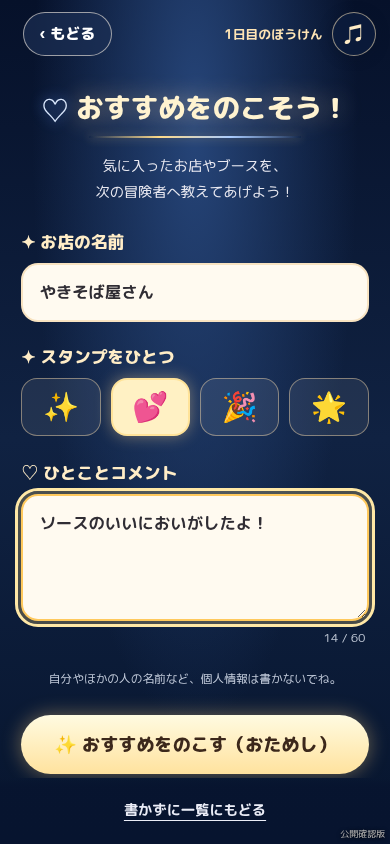
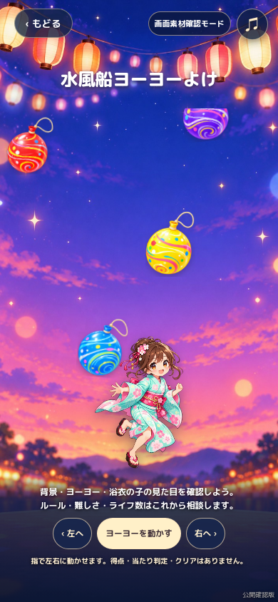
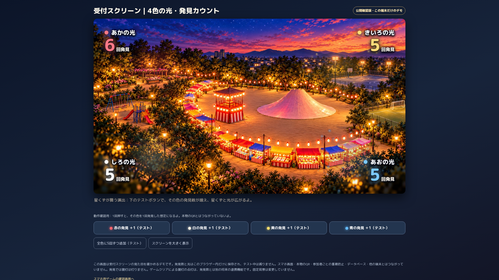
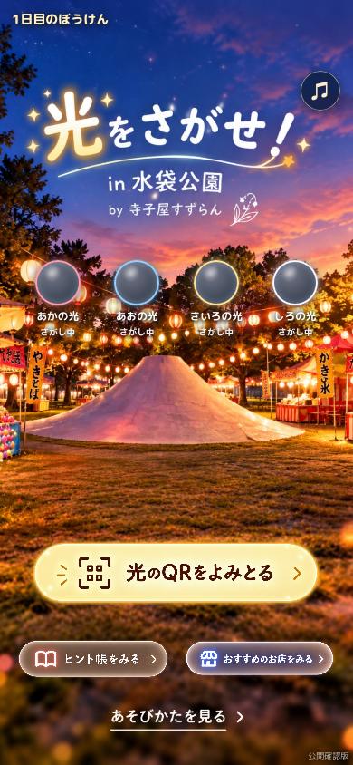
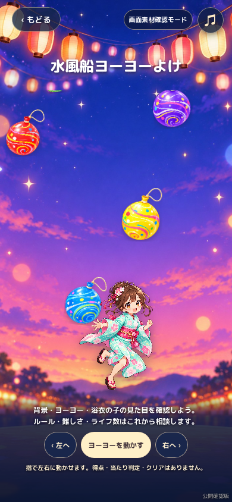

# 公開確認版の検証記録

2026年10月23日。公開前のローカル配信で検証しています。GitHub Pagesで公開できたことを示す記録ではありません。

## 実行した確認

- `npm ci --ignore-scripts --no-audit --no-fund --cache /tmp/hikari-npm-cache`：固定ロックファイルによるテスト依存関係のインストール。
- `npm test`：Playwright 1.62.1＋Chromium 154.0.8037.57、15シナリオ成功、失敗0。
- `BROWSER=webkit PLAYWRIGHT_BROWSERS_PATH=/workspace/scratch/pw-browsers WEBKIT_EXECUTABLE_PATH=/workspace/scratch/pw-browsers/webkit-2336/pw_run.sh npm test`：WebKit 26.5、同じ15シナリオ成功、失敗0。両エンジン計30シナリオ成功。
- スマホは360×800、390×844、430×932。タッチ操作とAndroid／iPhone相当のUA設定を使用。各エンジンで同じサイズを検証。
- 受付は1920×1080およびスマホ幅。ステージの比率が16:9で、4隅が赤・白・黄・青の指定位置にあることを確認。
- 各HTMLのID重複なし、相対参照の存在、JavaScript構文、`git diff --check` を確認。
- 添付素材20ファイルと参考HTMLから抽出したボタン3ファイルのSHA-256を確認。背景・キャラクター・音源の原本を変更していない。

## 確認した操作

| 対象 | 結果 |
| --- | --- |
| 起動・はじめ・ホーム・あそびかた | 正常に遷移し、戻る。4色の光は横並び、画像の引き伸ばし・横スクロールなし |
| QR・発見 | カメラを要求せずテストボタンから発見表示。再読込で色が変わったり、履歴を戻るだけで発見が増えたりしない |
| ヒント | 入力条件、色別一覧、1日目／2日目の分離、再読込後の端末内記録を確認 |
| お店 | 店名・スタンプ1つ・コメントを保存・一覧・詳細表示。写真入力なし。入力したHTMLは文字として表示 |
| BGM | ユーザー操作後に実MP3を再生。赤の素材画面を含め画面遷移中も継続し、停止操作も維持 |
| 赤 | 指定背景、6種類のPNG、採用済み浴衣の子を表示。左右移動は素材配置の確認のみ。得点・当たり判定・ライフ・クリア判定なし |
| 受付 | 加算と再読込保存。スマホ側の発見では増えない。カウント・光を減らす操作なし |
| 保存制限・モーション軽減 | 保存不可でも画面内デモが動き、保存できない旨を表示。モーション軽減時は初期停止 |
| 素材・通信 | 実PNG・WOFF2のデコードと実MP3再生を確認。ページエラー・読込失敗・外部サービス要求なし。GPS・カメラ要求なし |

## 画面

いずれも実装したサイトのブラウザースクリーンショットです。素材の生成やデザインの作り直しはしていません。

| はじめ | 冒険ホーム |
| --- | --- |
|  |  |

| QRテスト | ヒント帳 |
| --- | --- |
|  |  |

| お店の投稿 | 赤の素材確認 |
| --- | --- |
|  |  |

WebKitでも、同じ画像・配置を確認しました。

| WebKitの冒険ホーム | WebKitの赤の素材確認 |
| --- | --- |
|  |  |

## WebKitの検証環境

配布先への通信制限が解消した後、Playwright公式配布のWebKit 2336を取得しました。Linux用ライブラリは署名検証済みDebian trixie配布元から取得し、チェックサムを検証したパッケージをブラウザー内の `sys/lib` へ展開しています。システムのファイルや、公式ブラウザー・Playwright本体・起動ラッパーは変更していません。

隔離環境のシステム `ldconfig` キャッシュにローカルライブラリが載らないため、上記コマンドではPlaywrightの標準 `executablePath` 設定で同じ公式起動ファイルを指定しています。実行ファイル・共有ライブラリ63ファイルの `ldd` と `libGLESv2` の実ロードで依存解決を確認し、その上で画面・音声を含む機能テストを実施しました。パッケージ署名・チェックサム・TLS検証の無効化はしていません。

## まだ確認していないこと

- Android／iPhone実機・Safariアプリ自体の画面や音声出力、屋外通信、実際の受付スクリーンでの色・明るさ。
- GitHub Pages上での表示・HTTPSでの到達。公開手順はREADMEを参照してください。
- 実QR・本番ゲーム・クラウド共有・提灯の本番連動は実装対象外のため動作確認していません。GPS・写真アップロード・本番DB接続もありません。
